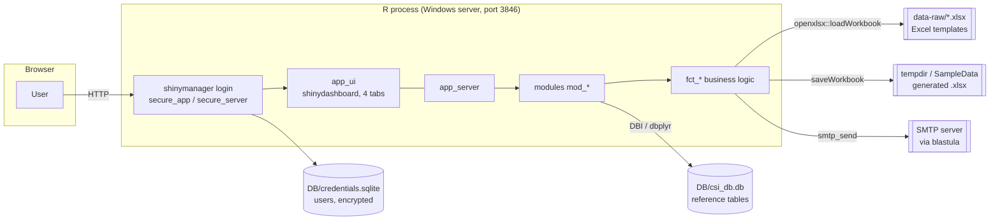
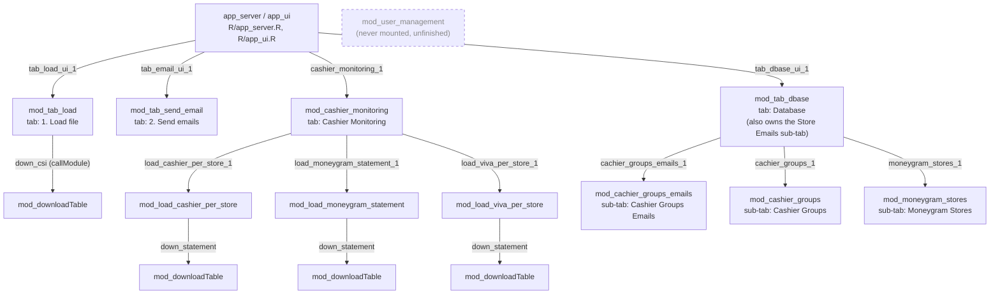
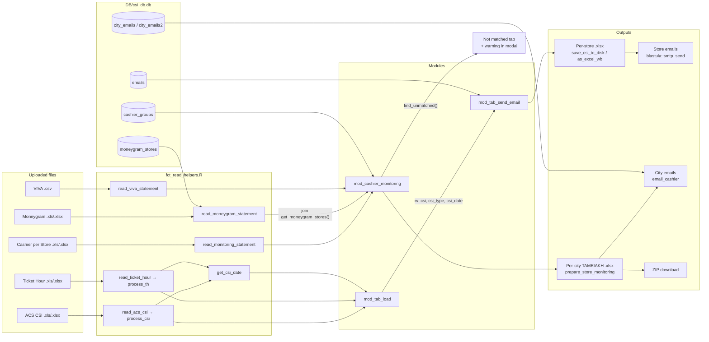
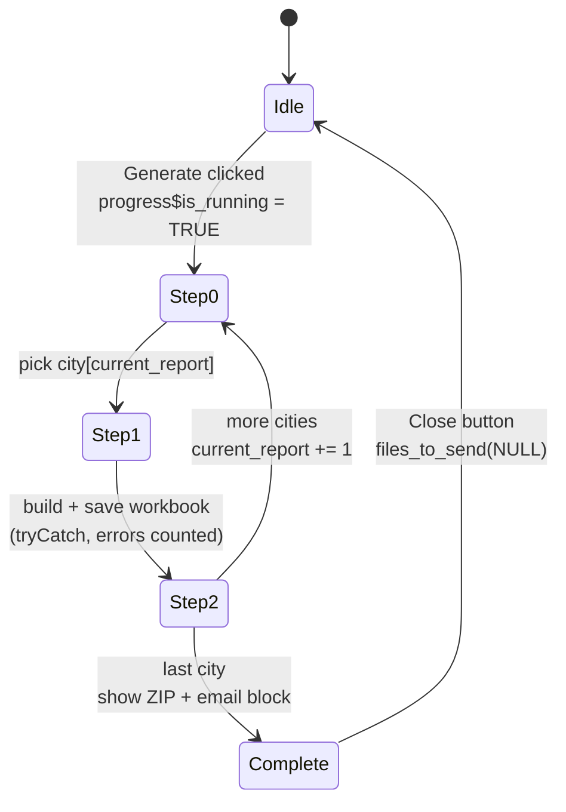

# 01 – Architecture

## The big picture

CSIemail is a **golem app**: it's built as an R package (`CSIemail`, [DESCRIPTION](../../DESCRIPTION)) whose only exported entry point is `run_app()` ([R/run_app.R:10](../../R/run_app.R#L10)). All the app code lives in `R/`. Nothing is `source()`d. In development you load the package with `pkgload::load_all()` or `golem::document_and_reload()`, and in production `app.R` does the same ([app.R:5](../../app.R#L5)).

### How golem conventions are applied here

| Convention | Used here | Notes |
|---|---|---|
| `R/app_ui.R`, `R/app_server.R`, `R/run_app.R` | ✅ | `run_app()` wraps `app_ui` in `shinymanager::secure_app(enable_admin = TRUE)` ([R/run_app.R:20](../../R/run_app.R#L20)) |
| `R/app_config.R` + `inst/golem-config.yml` | ✅ | `get_golem_config()` ([R/app_config.R:41](../../R/app_config.R#L41)) reads the YAML through `config::get()`. Three profiles: `default`, `production`, `dev` |
| `mod_<name>.R` with `mod_<name>_ui(id)` / `mod_<name>_server(id, …)` | ✅ | Mostly `moduleServer()` style. **Exception:** `mod_downloadTable_server` uses the legacy `callModule()` signature ([R/mod_downloadTable.R:24](../../R/mod_downloadTable.R#L24)) |
| `fct_*.R` for business logic | ✅ | A few helper files are named `mod_*_fct_helpers.R` instead ([R/mod_tab_dbase_fct_helpers.R](../../R/mod_tab_dbase_fct_helpers.R), [R/mod_tab_send_emails_fct_helpers.R](../../R/mod_tab_send_emails_fct_helpers.R)) |
| `utils_*.R` | ❌ | None. Only golem's own `golem_utils_ui.R` / `golem_utils_server.R` |
| `inst/app/www` | ✅ | Bundled automatically by `golem_add_external_resources()` ([R/app_ui.R:81](../../R/app_ui.R#L81)); every `.css` / `.js` file in it gets loaded |
| `data-raw/` → `R/sysdata.rda` | ✅ | Internal constants, built by [data-raw/create_global_values.R](../../data-raw/create_global_values.R) |
| `dev/01_start.R`, `02_dev.R`, `03_deploy.R` | Template only | Unedited golem boilerplate, so they tell you nothing about the real history |
| `tests/` | ✅ | `testthat` edition 3 suite (since 2026-11-07), with a synthetic DB fixture ([05](05-setup-and-running.md#tests)) |
| `R/_disable_autoload.R` | ✅ | Stops Shiny from auto-sourcing `R/` when `runApp()` is pointed at the folder |

## Module tree

Every module and the ID it's mounted under. Namespaced IDs nest, so the Moneygram loader's full ID is `cashier_monitoring_1-load_moneygram_statement_1`.

Where they're wired up: UI in [R/app_ui.R:47-66](../../R/app_ui.R#L47-L66), server in [R/app_server.R:103-146](../../R/app_server.R#L103-L146), monitoring children in [R/mod_cashier_monitoring.R:217-221](../../R/mod_cashier_monitoring.R#L217-L221), Database children in [R/mod_tab_dbase.R:46-48](../../R/mod_tab_dbase.R#L46-L48).

The IDs `cachier_groups_emails_1` and `cachier_groups_1` are misspelt ("cachier"). Any code that refers to them has to use the misspelling.

## Data flow

The two halves never touch: nothing from the CSI/email flow (tabs 1–2) reaches the cashier monitoring flow (tab 3). The only thing they share is the SQLite connection.

## State and reactivity

### App-level state ([R/app_server.R](../../R/app_server.R))

| Object | Type | Set by | Read by |
|---|---|---|---|
| `rv$csi`, `rv$stores`, `rv$csi_date`, `rv$csi_type` | `reactiveValues` ([L28](../../R/app_server.R#L28)) | observer copying `load$stores` etc. from `mod_tab_load_server`'s returned `rv` ([L105-L112](../../R/app_server.R#L105-L112)) | `mod_tab_send_email_server`, passed in as `reactive(rv$…)` wrappers ([L118-L124](../../R/app_server.R#L118-L124)) |
| `rv$db_trigger` | counter | bumped whenever `mod_tab_dbase_server`'s returned `db_trigger` changes ([L132-L136](../../R/app_server.R#L132-L136)) | `mod_tab_send_email_server`'s `trigger()`, so it re-reads the `emails` table |
| `dbase_csi` | DBI SQLite connection, **one per session** ([L80](../../R/app_server.R#L80)) | `app_server` | passed into the Send-email, Database and Monitoring modules |
| `session$userData$user` | string | observer on the shinymanager result ([L64-L66](../../R/app_server.R#L64-L66)) | `output$userName` in the sidebar only |

### Patterns used for module communication

1. **Returning a `reactiveValues`.** This is the house style. Loader modules return their internal `rv` and the parent watches it with `observeEvent(child$field, …)`. Examples: [R/mod_tab_load.R:207](../../R/mod_tab_load.R#L207), [R/mod_load_viva_per_store.R:179](../../R/mod_load_viva_per_store.R#L179), consumed at [R/mod_cashier_monitoring.R:224-272](../../R/mod_cashier_monitoring.R#L224-L272).
2. **Passing reactives down.** The parent wraps values in `reactive()` before handing them to a child (`mod_tab_send_email_server`).
3. **A trigger counter (`db_trigger`) to force DB re-reads.** Each CRUD module bumps its own local `rv$db_trigger` after a write, and its `tbl(...) %>% collect()` reactive depends on it.
   - **Only `mod_tab_dbase_server`'s own trigger reaches the app level.** Edits in the three sub-modules (city emails, cashier groups, Moneygram stores) don't propagate.
   - `mod_cashier_monitoring_server` reads the cashier recipients and `cashier_groups` in reactives driven by **its own** counters, `emails_refresh` and `groups_refresh` ([R/mod_cashier_monitoring.R:123-147](../../R/mod_cashier_monitoring.R#L123-L147)). They're bumped when the user clicks Send, Generate, or Re-check, so Database-tab edits are picked up at the moment they matter, without propagating triggers across modules.
   - The Moneygram mapping is the exception. `get_moneygram_stores()` re-reads it every time a statement is loaded ([R/mod_load_moneygram_statement.R:128-130](../../R/mod_load_moneygram_statement.R#L128-L130)).
4. **Custom JS messages for live progress.** The monitoring module pushes HTML into the modal with `session$sendCustomMessage("updateProgress" | "updateProgressEmail", html)`. The handlers are inline `<script>` tags in [R/mod_cashier_monitoring.R:15-24](../../R/mod_cashier_monitoring.R#L15-L24). They target **non-namespaced** element IDs (`#progress_content`, `#email_progress_content`), so the module would break if it were mounted twice on one page.

No `gargoyle`, R6, `session$userData` messaging or `petite-r6` patterns are used.

### The report-generation state machine

Generating the per-city workbooks is long-running, and Shiny can't flush UI updates in the middle of an observer. So [R/mod_cashier_monitoring.R:361-491](../../R/mod_cashier_monitoring.R#L361-L491) handles one step per tick of `reactiveTimer(500)`:

`progress` is a `reactiveValues` ([L104](../../R/mod_cashier_monitoring.R#L104)). A separate observer ([L327-L355](../../R/mod_cashier_monitoring.R#L327-L355)) re-renders the progress bar whenever `progress$messages` changes.

### Package-level and global state

| What | Where | Why it matters |
|---|---|---|
| `safe_readXL`, `safe_readCSV` | defined as dummies, then reassigned with `<<-` in `.onLoad` ([R/zzz.R:14-19](../../R/zzz.R#L14-L19)) | `purrr::safely()` wrappers built at load time. If you call them without loading the package, you get the dummy that returns `"dummy"` |
| `rv` | alias for `shiny::reactiveValues` ([R/golem_utils_server.R:62](../../R/golem_utils_server.R#L62)) | Many modules also use a *local* variable called `rv`. Where none exists, `rv` silently resolves to this function (see the dead `add_to_db` observer in [07-maintenance-guide.md](07-maintenance-guide.md)) |
| Process locale | `Sys.setlocale(locale = "greek")` in `save_csi_to_disk()` ([R/mod_tab_send_emails_fct_helpers.R:5-6](../../R/mod_tab_send_emails_fct_helpers.R#L5-L6)) | Changes the locale for the **whole R process**, which every session shares. It's reset with `on.exit` |
| Internal data | `R/sysdata.rda` | `db_tables`, `names_cashier_per_store`, `col_names_ticket`, `vars_sum_ticketHour`, `statement_types`, plus three unused workbook objects |

All sessions share one R process (a single `runApp`), so the long, blocking operations (sending emails, building workbooks) **block every other user** while they run.
