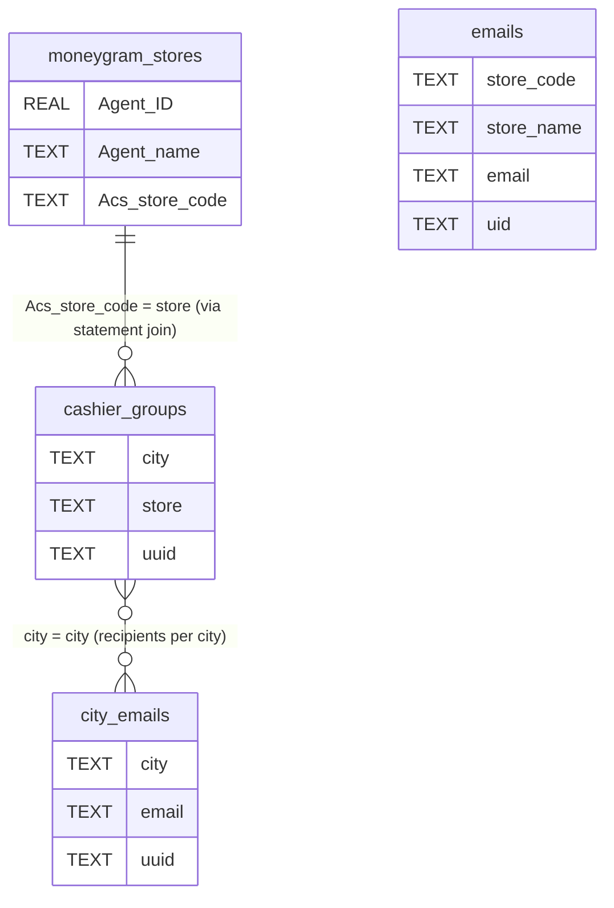
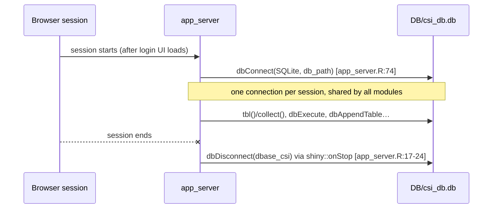

# 03 – Data and databases

## Summary of data sources

| Source | Kind | Connection method | Config / env needed |
|---|---|---|---|
| `DB/csi_db.db` | SQLite | `DBI::dbConnect(RSQLite::SQLite(), path)`. Reads go through `dplyr::tbl()` + `collect()`, which needs `dbplyr` | config key `db_path` |
| `DB/credentials.sqlite` | SQLite (shinymanager, encrypted) | `shinymanager::check_credentials(db, passphrase)` | config keys `db_users`, `users_passphrase` |
| Uploaded files | xls / xlsx / csv | `readxl::read_excel`, `readr::read_csv` (mostly through `safe_readXL` / `safe_readCSV`) | none |
| Excel templates | xlsx in `data-raw/` | `openxlsx::loadWorkbook` | config keys `acs_template`, `th_template`, `cashier_template` |
| Generated reports | xlsx files | `openxlsx::saveWorkbook` | config key `path_store_reports` (cashier reports). CSI attachments always go to `tempdir()` |
| SMTP | email | `blastula::smtp_send` | config keys `smtp_creds` and `smtp_creds_source`, plus a creds file or keyring entry ([05](05-setup-and-running.md#smtp-credentials)) |
| `ipinfo.io` | external HTTP call **from the browser** | [inst/app/www/getIP.js](../../inst/app/www/getIP.js) | none. The result (`input$getIP`) is never used |
| `R/sysdata.rda` | internal R data | loaded automatically with the package | rebuilt from `data-raw/` |

There are no APIs (`httr`/`httr2`), no S3 or SFTP, and no cached `.rds`/`.qs` files read at runtime. `inst/extdata/` and `data/` don't exist. (`data-raw/create_store_email_table.R` writes a `DB/tbl_store_emails.rds`, but no app code reads it.)

All paths in config are **relative to the working directory** (`DB/csi_db.db`, `data-raw/…`). The app must be started from the repo root. `runApp(<folder>)` in production takes care of that.

## `DB/csi_db.db`: table reference

The schema below was read from the local copy. Column types are SQLite affinities.

| Table | Columns | Read by | Written by |
|---|---|---|---|
| **`emails`** (`db_tables$store_emails`) | `store_name` TEXT, `email` TEXT, `uid` TEXT, `store_code` TEXT | `mod_tab_send_email` `tbl_emails` ([R/mod_tab_send_email.R:51-61](../../R/mod_tab_send_email.R#L51-L61)); `mod_tab_dbase` ([R/mod_tab_dbase.R:60-67](../../R/mod_tab_dbase.R#L60-L67)) | `mod_tab_dbase`: insert [L134](../../R/mod_tab_dbase.R#L134), update [L144-149](../../R/mod_tab_dbase.R#L144-L149), delete [L231](../../R/mod_tab_dbase.R#L231). Seeded (and **overwritten**) by [data-raw/create_store_email_table.R](../../data-raw/create_store_email_table.R) |
| **`city_emails`** (`db_tables$city_emails`) | `city` TEXT, `email` TEXT, `uuid` TEXT | `mod_cashier_monitoring` when `cashier_emails_table: city_emails` (the `production` profile) ([R/mod_cashier_monitoring.R:129-138](../../R/mod_cashier_monitoring.R#L129-L138)); `mod_cachier_groups_emails` | `mod_cachier_groups_emails`: insert [L111](../../R/mod_cachier_groups_emails.R#L111), update [L121-125](../../R/mod_cachier_groups_emails.R#L121-L125), delete [L206](../../R/mod_cachier_groups_emails.R#L206) |
| **`city_emails2`** | same as `city_emails` | `mod_cashier_monitoring` when the config key `cashier_emails_table` is `city_emails2` (the `default` and `dev` profiles; [R/mod_cashier_monitoring.R:129-138](../../R/mod_cashier_monitoring.R#L129-L138), [R/fct_email_helpers.R:54](../../R/fct_email_helpers.R#L54)) | nothing in the app. Edit it by hand |
| **`cashier_groups`** (`db_tables$cashier_groups`) | `city` TEXT, `store` TEXT, `uuid` TEXT | `mod_cashier_monitoring` `store_groups` ([L140-L147](../../R/mod_cashier_monitoring.R#L140-L147)), which defines the cities and the stores in each; `mod_cashier_groups` | `mod_cashier_groups`: insert [L107](../../R/mod_cashier_groups.R#L107), update [L117-121](../../R/mod_cashier_groups.R#L117-L121), delete [L194](../../R/mod_cashier_groups.R#L194) |
| **`moneygram_stores`** (literal name, not in `db_tables`) | `` `Agent ID` `` REAL, `` `Agent name` `` TEXT, `` `Acs store code` `` TEXT | `get_moneygram_stores()` ([R/fct_dbase_operations.R:47-55](../../R/fct_dbase_operations.R#L47-L55)); `mod_moneygram_stores` | `mod_moneygram_stores`: insert [L156](../../R/mod_moneygram_stores.R#L156), update [L166-174](../../R/mod_moneygram_stores.R#L166-L174), delete [L243](../../R/mod_moneygram_stores.R#L243) |
| **`cashier_per_store`** (`db_tables$cashier_per_store`) | `store`, `courier` TEXT; `trans`, `buy_pay`, `buy_get`, `an_cash`, `total_cash`, `an_cheques`, `tip`, `total_card` REAL; `date` TEXT | nothing live | only the **dead** `add_to_db` observer ([R/mod_cashier_monitoring.R:690-764](../../R/mod_cashier_monitoring.R#L690-L764)) through `append_to_db()`. The local copy holds historic rows |

There are no primary keys, unique constraints or indexes. Uniqueness is enforced only in R, and only for `moneygram_stores` ([R/mod_moneygram_stores.R:128-149](../../R/mod_moneygram_stores.R#L128-L149)). `uid`/`uuid` values come from `uuid::UUIDgenerate()`, but only for rows added through the app. In the local copy, **36 of 37 `cashier_groups` rows have a NULL `uuid`**, probably imported before the column was added, so Edit and Delete silently do nothing for them (B1b in [07](07-maintenance-guide.md#correctness-bugs)).

> ⚠️ TO CONFIRM: is `city_emails2` a test copy holding internal recipients, so that dev runs never email real cashiers? Is the `cashier_per_store` table (and the "add statement to DB" feature) retired for good?

### Relationships (inferred from joins; nothing enforces them)

- `cashier_groups.city` ↔ `city_emails.city`: who receives each city's report ([R/mod_cashier_monitoring.R:520-522](../../R/mod_cashier_monitoring.R#L520-L522)). This is a case-sensitive exact match.
- `cashier_groups.store` ↔ the `store` column of all three statements ([L385-L405](../../R/mod_cashier_monitoring.R#L385-L405)):
  - the Cashier per Store report's `Κατάστημα:` marker
  - `moneygram_stores.Acs store code`, after the join
  - VIVA `ACS Account Code/Store`, with its `-1` suffix stripped

  **Any store missing from `cashier_groups` is left out of every city report.** The same goes for a Moneygram agent missing from `moneygram_stores`: its row ends up with `store = NA`. Since 2026-11-07 these rows are **listed** in the "Not matched" tab and in the Generate modal (`find_unmatched()`, [R/fct_unmatched.R:16](../../R/fct_unmatched.R#L16)) instead of disappearing without a trace.
- `emails.store_code` ↔ the CSI `store_code` ([R/mod_tab_send_email.R:119](../../R/mod_tab_send_email.R#L119)). A store with no row in `emails` shows up with no address and can't be sent to.

## `DB/credentials.sqlite`: users

This is managed entirely by `shinymanager`. Tables: `credentials`, `logs`, `pwd_mngt`. It's encrypted with the passphrase from config key `users_passphrase` ([R/app_server.R:46-55](../../R/app_server.R#L46-L55)). Users are managed through shinymanager's built-in **admin panel** (`enable_admin = TRUE`, [R/run_app.R:21](../../R/run_app.R#L21)), which admin users see after logging in.

The app's own code never queries this DB. `Scripts/01-create_db_users.R` (git-ignored) is probably how it was first created.

> ⚠️ TO CONFIRM: how the credentials DB was first created, and who holds admin accounts.

Other files in `DB/` that the app doesn't use: `users.db` (a `users` table with a `password` column), `credentials.csv`, and CSV exports (`cashier_groups.csv`, `cashier_per_store.csv`, `city_emails*.csv`). Treat `users.db` and `credentials.csv` as **potentially holding plaintext passwords**.

## All SQL in the app

| Statement | Location | Purpose | Parameterised? |
|---|---|---|---|
| `tbl(conn, <table>) %>% collect()` (dbplyr `SELECT *`) | every read listed above | read whole tables | n/a |
| `UPDATE emails SET store_name=$store_name, store_code=$store_code, email=$email WHERE uid=$uid` | [R/mod_tab_dbase.R:146](../../R/mod_tab_dbase.R#L146) | edit a store email | ✅ |
| `UPDATE city_emails SET city=$city, email=$email WHERE uuid=$uuid` | [R/mod_cachier_groups_emails.R:123](../../R/mod_cachier_groups_emails.R#L123) | edit a city email | ✅ |
| `UPDATE cashier_groups SET city=$city, store=$store WHERE uuid=$uuid` | [R/mod_cashier_groups.R:119](../../R/mod_cashier_groups.R#L119) | edit a city/store pair | ✅ |
| ``UPDATE moneygram_stores SET `Agent name`=$name, `Acs store code`=$store WHERE `Agent ID`=$id`` | [R/mod_moneygram_stores.R:168](../../R/mod_moneygram_stores.R#L168) | edit a mapping | ✅ |
| `DELETE FROM <table> WHERE <col> = :x` | `delete_data()` [R/mod_tab_dbase_fct_helpers.R:329](../../R/mod_tab_dbase_fct_helpers.R#L329) | all deletes | value ✅; table/column pasted in |
| `dbAppendTable(conn, table, df)` | `append_data()` [L316](../../R/mod_tab_dbase_fct_helpers.R#L316), `append_to_db()` [R/fct_dbase_operations.R:15](../../R/fct_dbase_operations.R#L15) | inserts | ✅ |
| `SELECT COUNT(*) as count FROM '<type>' WHERE date = '<date>'` | `check_statement_in_db()` [R/fct_dbase_operations.R:67](../../R/fct_dbase_operations.R#L67) | duplicate check (dead code) | ❌ glue string |
| `dbWriteTable(dbase, "emails", all_emails, overwrite = TRUE)` | [data-raw/create_store_email_table.R:67](../../data-raw/create_store_email_table.R#L67) | **one-off seed script: replaces the whole table** | n/a |

There are no `.sql` files.

The `$name` placeholders in the UPDATEs are bound from `as.list(form_data())`. The data-frame column names have to match the placeholder names exactly.

## Connection lifecycle

- There's **no pooling** (`pool` isn't used). Calling `shiny::onStop()` inside the server function registers a callback for when *that session* ends, not when the app stops.
- `append_to_db()` and `check_statement_in_db()` open and close their own short-lived connections. Both are dead code paths.
- SQLite allows concurrent readers but only one writer at a time. With a few users that's fine; two simultaneous writes could raise "database is locked", which shows up as the generic error modal.

### What happens when the DB is unavailable

- **Wrong or missing `db_path`:** `RSQLite` **creates a new, empty DB file** without complaint. The app starts, then every `tbl()` call fails with "no such table" inside a reactive, so the Shiny output shows an error, or the session crashes if it happens in an observer. Check `DB/` exists before starting.
- **Reads have no error handling.** None of the `tbl() %>% collect()` calls is wrapped.
- **Writes** in the CRUD modules are wrapped in `tryCatch`. They print the error to the console and show `modal_error_editing_dbase()`.
- **The credentials DB is missing or the passphrase is wrong:** shinymanager can't authenticate anyone, so nobody can log in.

## Uploaded file formats (what the readers expect)

| Upload | Extension | Required structure | Reader |
|---|---|---|---|
| ACS CSI | xls/xlsx | Two unnamed leading columns (date-ish, then `"…: <store code>"` markers); named columns including `AWB` and the invoice column `Τιμολόγιο`; numeric columns from `AWB` to the end | `read_acs_csi` + `process_csi` |
| Ticket Hour Sales | xls/xlsx | At least 15 columns **in the fixed order** of `col_names_ticket` (store code, store name, contact, empty, ticket id, items, type, date, reference, details, value, star, os, debit, credit) | `read_ticket_hour` + `process_th` |
| Cashier per Store | xls/xlsx | Column 1 holds courier names and store marker rows (`Κατάστημα: XX`). Headers must include the Greek "total cash" and "total card" columns from `names_cashier_per_store` | `read_monitoring_statement` |
| Moneygram activity | xls/xlsx | Column 1 has the labels `Agent ID`, `Agent Name`, `TOTAL, EUR` in repeating triplets. Values are in column 2 (ID, name) or column 8 (total). The file name contains an 8-digit `ddmmyyyy` date | `read_moneygram_statement` |
| VIVA | csv | Columns `Transaction Type`, `ACS Account Code/Store`, `Amount`, `Day` (`dd/mm/yyyy`). Exactly one distinct day | `read_viva_statement` |

Examples of each are in `SampleData/` (git-ignored). For instance:
- `csi 23092021.xls`
- `TH REPORT EXCEL.xls`
- `_CASHIERS_CITY_USERS.xlsx`
- `_Activity Moneygram 24092025.xls`
- `_VIVA_24-10-2025.csv`, plus `_VIVA_24-10-2025_2dates.csv` to test rejection

> ⚠️ TO CONFIRM: these formats were inferred from the parsing code and the sample file names. Which source systems export each file, and are their layouts stable?

## Internal constants (`R/sysdata.rda`)

| Object | Content | Used by |
|---|---|---|
| `db_tables` | `list(cashier_per_store, cashier_groups, city_emails, store_emails = "emails")` | the modules |
| `names_cashier_per_store` | named chr: internal name → Greek header, written as `\u` escapes (`courier`, `trans`, `buy_pay`, `buy_get`, `an_cash`, `total_cash`, `an_cheques`, `tip`, `total_card`) | `read_monitoring_statement`, monitoring. `select(all_of(names_cashier_per_store))` **renames** the Greek headers to the internal names |
| `col_names_ticket` | named chr: label → internal name, for the 15 TH columns | `read_ticket_hour`, TH preview relabelling |
| `vars_sum_ticketHour` | `c("os", "debit", "credit")` | totals |
| `statement_types` | `c("Cashier per Store" = "cashier_per_store", "Moneygram" = "moneygram")` | unused |
| `xl_template_ACS_CSI`, `xl_template_TH_CSI`, `xl_template_store_monitoring` | openxlsx Workbook objects | unused. The templates are loaded from the config paths instead |

Source script: [data-raw/create_global_values.R](../../data-raw/create_global_values.R). It **won't run as it stands**, because `xl_template_store_monitoring` is passed to `use_data()` but never created. See [07](07-maintenance-guide.md#regenerate-rsysdatarda).

## Credentials and where they live (no values)

| Secret | Location | Purpose | In git? |
|---|---|---|---|
| shinymanager passphrase | `inst/golem-config.yml`, key `users_passphrase` (default profile, inherited by the others) | decrypts `DB/credentials.sqlite` | **No longer tracked**: `inst/golem-config.yml` is git-ignored and copied to each machine by hand, and the committed template has a placeholder. Older commits still contain the file |
| Dev SMTP credentials | file `mail_improvast` in the repo root (name from `smtp_creds` in the `default`/`dev` profiles) | blastula creds file: SMTP host, user and password | No (`.gitignore`) |
| Prod SMTP credentials | OS keyring entry with id `acs` (`smtp_creds` in `production`) on the server | blastula creds key | No |
| User accounts | `DB/credentials.sqlite` (encrypted); `DB/users.db`, `DB/credentials.csv` (unused, possibly plaintext) | login | No |
| Initial user passwords | `Scripts/01-create_db_users.R` (probably hardcoded) | user DB creation | No |
| Excel sheet-protection password | applied to `data-raw/template_report.xlsx` (the hash is stored in the file); an unprotected copy `template_report_unprotected.xlsx` exists | stops cashiers editing formula cells | template yes, password no |

> ⚠️ TO CONFIRM: who knows the template protection password, and which Windows account on the server owns the `acs` keyring entry.

Environment variable **names** used: `GOLEM_CONFIG_ACTIVE`, `R_CONFIG_ACTIVE` (fallback in `active_config()`) and `RENV_PATHS_LIBRARY` (`.Renviron`). The R **option** `golem.app.prod` is set by `app.R` and `run_dev.R`, but it only matters as a fallback when a machine's config lacks the `smtp_creds_source` / `cashier_emails_table` keys. See [05-setup-and-running.md](05-setup-and-running.md#renviron-template).
