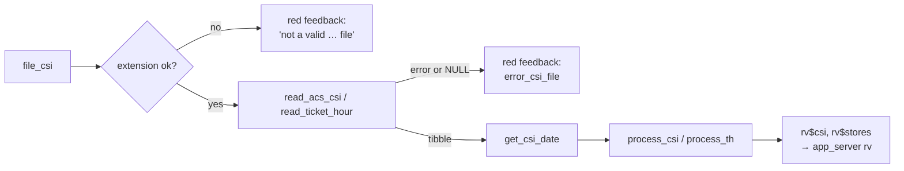

# 04 – Functionality walkthrough

This page goes tab by tab: what the user does, what the code does, and the validation and business rules involved. Tab labels come from [R/app_ui.R:26-30](../../R/app_ui.R#L26-L30).

> ⚠️ TO CONFIRM: the business vocabulary.
> - *CSI* = Cash Sales Invoice, per [README.md](../../README.md).
> - *Ticket Hour Sales* is the name of a second sales channel or partner.
> - *ΤΑΜΕΙΑΚΗ / Tamiaki* is Greek for "cash register (report)".
> - *VIVA* appears to be the card-payment provider (Viva Wallet).
>
> The code alone can't explain these. The previous maintainer should check the glossary.

## Login

`shinymanager::secure_app` shows a login page with the heading "Cash Sales Invoice - Emails" and `www/logo.png` ([R/run_app.R:20-28](../../R/run_app.R#L20-L28)). Credentials are checked against `DB/credentials.sqlite`. Once logged in, the sidebar shows:
- `User: <name>`
- the app version (from `DESCRIPTION`)
- the active mode: `Config: <profile>`, `SMTP credentials: file|keyring`, `Cashier emails: <table>`. A red **(TEST)** appears when cashier reports go to the test list. Admin users also get shinymanager's admin panel for managing users (add, reset passwords, see logs).

Every logged-in user can do everything. The app has **no roles or permissions** of its own.

---

## Tab 1: Load file

**What the user does**
1. Picks the statement type: **ACS CSI** or **Ticket Hour Sales**.
2. Uploads an `.xls` or `.xlsx`. The `fileInput` also accepts `.csv` in its file picker, but the server rejects it for both types ([R/mod_tab_load.R:72-87](../../R/mod_tab_load.R#L72-L87)).
3. On success, gets a green "… file read OK!" and a **View a store's csi** box. They pick a store to preview its rows plus a **Total** row, and can download that store's data with **Download .xlsx**.

**What happens in the code** ([R/mod_tab_load.R:62-139](../../R/mod_tab_load.R#L62-L139))

**Rules**

| Rule | Where |
|---|---|
| ACS CSI: store code = the text after `": "` in the second column, filled down through the rows below it | `process_csi` [R/fct_read_helpers.R:227-237](../../R/fct_read_helpers.R#L227-L237) |
| ACS CSI: rows without an invoice number (`Τιμολόγιο`) are subtotal lines and get dropped. Totals are recalculated | [R/fct_read_helpers.R:240-243](../../R/fct_read_helpers.R#L240-L243) |
| ACS CSI: the date is the text after `": "` in the first `date` cell | `get_csi_date` [L300-302](../../R/fct_read_helpers.R#L300-L302) |
| Ticket Hour: a file whose `os`, `debit` and `credit` columns are all empty is invalid | `read_ticket_hour` [L25-32](../../R/fct_read_helpers.R#L25-L32) |
| Ticket Hour: the "date" is a from/to range (min and max transaction date) | `get_csi_date` [L304-306](../../R/fct_read_helpers.R#L304-L306) |
| Totals row: ACS sums every column except `AWB`. TH sums `os`, `debit`, `credit` | [R/mod_tab_load.R:168-174](../../R/mod_tab_load.R#L168-L174) |
| A store may appear several times in the file. That's expected | comment at [R/fct_read_helpers.R:225](../../R/fct_read_helpers.R#L225) |

---

## Tab 2: Send emails

The tab stays empty until a file has been loaded in Tab 1.

**What the user does**
1. Sees the transaction date(s), the data type, and how many stores have sales.
2. Selects one or more stores in the table, which can be searched and filtered. One row means one store-and-address pair. A store with several addresses shows several rows.
3. Clicks **Send Emails**, confirms in "Verify sending emails" (**OK Send!**), and waits behind the spinner.
4. Gets a success modal, "N email(s) have been send to M store(s)". The **Email is sent?** column flips to ✔️ for the addresses that worked.

**What happens in the code** ([R/mod_tab_send_email.R](../../R/mod_tab_send_email.R))

1. `tbl_emails()` reads the `emails` table. It's invalidated by the global `db_trigger`, so edits in Database › Store Emails show up here straight away.
2. `csi_by_store()` nests the CSI per store, adds a Total row, left-joins the emails on `store_code`, and assigns a file name of `<tempdir>/<store_code>_<dd-mm-yyyy>.xlsx`.
3. On confirmation:
   1. `save_csi_to_disk()` writes one workbook per row from the ACS or TH template
   2. `blastula::compose_email()` builds the body "Hello, The <type> is attached:" and adds the attachment
   3. `smtp_send()` runs once per row, wrapped in `purrr::safely`
4. Success is tracked per address. The temporary files are then deleted ([L392-415](../../R/mod_tab_send_email.R#L392-L415)).

**Rules and validation**

| Rule | Where |
|---|---|
| Nothing selected → "No stores are selected!" modal | [L215-224](../../R/mod_tab_send_email.R#L215-L224) |
| Selected stores with no address → error toast, nothing sent | [L228-240](../../R/mod_tab_send_email.R#L228-L240) |
| Subject: `CSI - <store> - Date:<dd-mm-yyyy>` (or `Ticket Hour Sales - …`) | [L311](../../R/mod_tab_send_email.R#L311) |
| From address = the `user` stored in the SMTP credentials | [L309](../../R/mod_tab_send_email.R#L309) |
| Attachment layout: template + data at row 8, store name and code in E5/E6, dates in B5/B6, generation time (EET) in B3, `(Total Amount : € x)` or `(O/S Amount : € x)` under the table | `as_excel_wb` [R/mod_tab_send_emails_fct_helpers.R:32-107](../../R/mod_tab_send_emails_fct_helpers.R#L32-L107) |
| If every send fails → "NO emails were send! Please check the email addresses" | [L366-373](../../R/mod_tab_send_email.R#L366-L373) |

The on-screen Ticket Hour preview (Tab 1) relabels columns using `col_names_ticket`, but the emailed TH attachment keeps the internal column names (`store_code`, `os`, …). `csi_by_store` doesn't relabel them.

> ⚠️ TO CONFIRM: is that intended?

---

## Tab 3: Cashier Monitoring

**What the user does**
1. Uploads three files in the left column, in any order:
   - **Cashier per Store report** (xls/xlsx)
   - **Moneygram Statement** (xls/xlsx)
   - **VIVA statement** (csv)

   Each successful upload shows a notification and switches the right-hand tabset to show that file.
2. Checks **Report Date**, which turns green once VIVA is loaded.
3. Checks the **Not matched** tab. It lists every row of the loaded statements that won't appear in any report, with the amount involved:
   - stores missing from Cashier Groups
   - Moneygram agents missing from Moneygram Stores

   A warning notification pops up as soon as such rows exist. After fixing the Database tables, the user clicks **Re-check against the Database**. Unmapped Moneygram agents also need the Moneygram file loaded again, because the mapping is applied at load time.
4. Clicks **Generate Reports and Email them**. Cashier Groups is re-read first. If anything is still unmatched, a yellow warning box at the top of the modal lists it. Below it, a progress bar and per-city messages appear ("✓ Limassol done!").
5. When it finishes:
   - **Download All Reports as ZIP**
   - and/or tick the cities and press **Send Emails to the selected cities**. Per-city results appear in the modal.
6. Clicks **Close**. That clears the generated-file list.

**What happens in the code** ([R/mod_cashier_monitoring.R](../../R/mod_cashier_monitoring.R))

For each city in `unique(cashier_groups$city)`, in table order, one city per 500 ms timer step ([L381-L432](../../R/mod_cashier_monitoring.R#L381-L432)):

1. `stores_in_city` = the `cashier_groups` stores for that city.
2. Cashier rows for those stores. The Greek headers are renamed to internal names, keeping `store, courier, total_cash, total_card`.
3. Moneygram rows for those stores. Each row is one agent, already mapped to `store` when the file was loaded.
4. VIVA `Amount` summed per store.
5. Load a fresh `cashier_template`, call `prepare_store_monitoring()`, and save it as `<path_store_reports>/TAMEIAKH_<city>-<YYYY-MM-DD>.xlsx`.
6. Errors are caught per city and counted. The remaining cities still go ahead.

Emailing ([L494-L580](../../R/mod_cashier_monitoring.R#L494-L580)): for each ticked city, `email_cashier()` sends one email to all of that city's addresses in the recipients table set by the config key `cashier_emails_table` (`city_emails` in production, the test list `city_emails2` otherwise). The table is re-read when Send is clicked. Subject: `Accounts report for <city>`.

**Rules and validation**

| Rule | Where |
|---|---|
| Cashier per Store must have a first column plus the Greek "Σύνολο Μετρητά" (total cash) and "Σύνολο Κάρτα" (total card) columns | `read_monitoring_statement` [R/fct_read_helpers.R:95-102](../../R/fct_read_helpers.R#L95-L102) |
| A store in the cashier report starts at a `Κατάστημα: <code>` ("Store:") row. Rows with an empty courier are per-store totals and are dropped | [L105-118](../../R/fct_read_helpers.R#L105-L118) |
| Moneygram totals in parentheses are negative | [R/fct_read_helpers.R:150-156](../../R/fct_read_helpers.R#L150-L156) |
| Moneygram agent → store comes from the `moneygram_stores` table, re-read every time a file loads. **Unmapped agents are excluded** from the reports, and listed in the Not matched tab | [R/mod_load_moneygram_statement.R:125-132](../../R/mod_load_moneygram_statement.R#L125-L132) |
| VIVA must contain exactly **one** distinct `Day`, otherwise "The VIVA statement has more than one date" | [R/mod_load_viva_per_store.R:109-126](../../R/mod_load_viva_per_store.R#L109-L126) |
| VIVA: only `Transaction Type == "SA"` rows count (sales, presumably; ⚠️ TO CONFIRM). A trailing `-1` on the store code is removed | [L134-142](../../R/mod_load_viva_per_store.R#L134-L142) |
| **The report date is the VIVA date.** The Moneygram file-name date is ignored | [R/mod_cashier_monitoring.R:256-266](../../R/mod_cashier_monitoring.R#L256-L266) |
| Generate is enabled once Cashier **and Moneygram** are loaded. VIVA isn't required for the button, but without it every city fails and the file name has no date | [L206-L215](../../R/mod_cashier_monitoring.R#L206-L215) |
| Only stores listed in `cashier_groups` appear in any report. The others are listed in the Not matched tab | [L385-L387](../../R/mod_cashier_monitoring.R#L385-L387) |
| No cities ticked → "Please select at least one city" | [L498-L501](../../R/mod_cashier_monitoring.R#L498-L501) |

### The generated workbook (`TAMEIAKH_<city>.xlsx`)

The template is [data-raw/template_report.xlsx](../../data-raw/template_report.xlsx), a single protected sheet named `Sheet1` that gets renamed to the city. Its **named ranges** are what make the formulas work:

| Named range | Cells | Column constant in code |
|---|---|---|
| `tamiaki` | B3:B1000 | `col_tamiaki = 2` |
| `cash_received` | C3:C1000 | `col_cash_received = 3` |
| `visa_received` | D3:D1000 | `col_visa = 4` |
| `cheques_received` | E3:E1000 | `col_cheques = 5` |
| *(difference)* | F | `col_difference = 6` |
| `viva_owed` | G3:G10000 | `col_viva_owed = 7` |
| *(notes)* | H | `col_notes = 8` |
| `moneygram_owed` | J3:J1000 | `col_moneygram_owed = 10` |
| `moneygram_received` | K3:K1000 | `col_moneygram_received = 11` |
| *(moneygram difference)* | L | `col_moneygram_difference = 12` |
| `total_owed` | N2 | `col_total_tamiaki_moneygram = 14` |
| `other_cheques` | N9:N18 | — |
| `total_received` | N19 | — |
| `viva_received` | **`#REF!`** (broken in the template) | not used by code |

Each store gets a block, starting at row 3 ([R/fct_prepare_store_monitoring.R:119-369](../../R/fct_prepare_store_monitoring.R#L119-L369)):

| Row | A | B (`tamiaki`) | C–E | F | G (`viva_owed`) | H | J | K | L |
|---|---|---|---|---|---|---|---|---|---|
| r | `Store: XX` (bold) | | | | VIVA total (yellow) | | Moneygram owed (yellow) | **input** (unlocked) | `=moneygram_received-moneygram_owed` |
| r+1 … | courier | courier cash total | **inputs**: cash, visa, cheques received (unlocked) | `=(cash_received+visa_received+cheques_received)-tamiaki` | r+1: card total from cashier report (yellow) | **notes** (unlocked) | | | |
| r+2 | | | | | `=G(r)-G(r+1)`: **red** if VIVA < card, **green** if equal | | | | |
| last | `" "` | store cash total (bold) | | | | | | | |

The formulas refer to whole-column named ranges, so each one reads the value on its own row (Excel implicit intersection).

Workbook-level cells:
- N2 = Σ Moneygram owed + Σ cash for the city
- N9:O18 are unlocked for "other cheques"
- O27:O28 are unlocked for deposits

The sheet protection itself comes from the template.

> ⚠️ TO CONFIRM: what "visa" means against "VIVA" in business terms. The code treats the cashier report's card total as what should match the VIVA settlement.

---

## Tab 4: Database

A box with four sub-tabs. Each one is a filterable table with **Add / Edit / Delete** buttons.

| Sub-tab | Table | Fields in the form | Used by |
|---|---|---|---|
| Store Emails | `emails` | Store Code, Store Name, Email | Tab 2 recipients |
| Cashier Groups Emails | `city_emails` | City Name, Email | Tab 3 recipients (production) |
| Cashier Groups | `cashier_groups` | City Name, Store | Tab 3: which stores go in which city report |
| Moneygram Stores | `moneygram_stores` | Agent ID, Agent name, Acs store code | Tab 3: Moneygram agent → store |

Interaction pattern:
- **Edit** and **Delete** need a selected row, otherwise a "Please select a row" warning appears.
- **Delete** asks for confirmation.
- Store, city and email rows can hold **several addresses for one store or city**. Each address is a separate row.

**Validation**
- *Moneygram Stores* ([R/mod_moneygram_stores.R:108-149](../../R/mod_moneygram_stores.R#L108-L149)):
  - Agent ID must be numeric and unique
  - store code is required and must not already be mapped to another agent (case-insensitive)
  - the Agent ID can't be changed when editing
- *Store Emails* and *Cashier Groups Emails* try to check the email format with a regex ([R/mod_tab_dbase.R:178-185](../../R/mod_tab_dbase.R#L178-L185)), but the check is broken: it passes the value instead of the input ID. In practice **no validation happens**, and empty or invalid emails can be saved.
- *Cashier Groups*: no validation.

**Refresh behaviour**
- Store Emails edits refresh Tab 2 straight away.
- Cashier Groups edits reach Tab 3 at the next **Generate** (or **Re-check against the Database**). Cashier Groups Emails edits reach it at the next **Send Emails**.
- Moneygram Stores edits apply the next time a Moneygram file is loaded.
