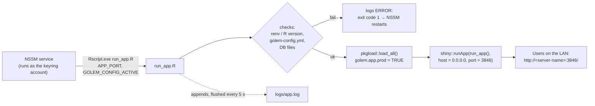

# 06 – Deployment

Production runs on an ACS Windows server as a **Windows service managed by [NSSM](https://nssm.cc/)**. NSSM starts R's `Rscript.exe` with the launcher script [run_app.R](../../run_app.R) in the project root. There's no `.bat` file. NSSM keeps the app running and restarts it if it crashes. Users open `http://<server-name>:3846/`.

This is the same setup as the DPI XML app (`tax_xml`) on the same server. The CSIemail launcher adds a few checks of its own: a golem package load, the config file, the database files, and the email mode.

| | |
|---|---|
| Port | `3846`. The DPI XML app uses `3845` and improreconcile `3844` |
| Folder on the server | `C:\Users\administrator.ACSCY\Documents\CSIemail` (the path the old launcher hard-coded) ⚠️ TO CONFIRM |
| NSSM service name | ⚠️ TO CONFIRM. The service already exists but used to point at `ShinyApp.bat`. The commands below use `%SVC%` |
| Windows account of the service | **must be the account that owns the `acs` keyring entry** (see 1.6) ⚠️ TO CONFIRM which one |
| R version | **4.2.3** (must match `renv.lock`) |
| Git branch | ⚠️ TO CONFIRM: `dev` or `master` |
| Log file | `logs\app.log` inside the app folder (plus `logs\service.log` from NSSM) |

The rest of this guide uses this folder and port. If yours differ, change them in every command.

## What's in the repo, and what isn't

| Artifact | Present? |
|---|---|
| [run_app.R](../../run_app.R) (root) | ✅ production launcher, started by NSSM. Not the same file as [R/run_app.R](../../R/run_app.R), which defines the package's `run_app()` function |
| [app.R](../../app.R) | ✅ golem's standard entry point, for "Run App" in RStudio. The service doesn't use it |
| [ShinyApp.bat](../../ShinyApp.bat), [launch_on_browser.R](../../launch_on_browser.R) | ⚠️ **deprecated, not used** since 2026-11-08. Replaced by `run_app.R`. Both files carry a deprecation header and are kept only for reference and for rolling back. Don't point the service at them |
| `Dockerfile`, `rsconnect/`, CI/CD, git tags | ❌ |

## What `run_app.R` does



1. **Finds its own folder** from the `--file=` argument and `setwd()`s there ([L24-32](../../run_app.R#L24-L32)). The `DB/…` and `data-raw/…` paths in the config are relative to it, so the script works wherever the project is cloned.
2. **Opens `logs/app.log`** for appending and sends both output and messages to it ([L35-50](../../run_app.R#L35-L50)). Each `log_line()` is flushed straight away, and a `later` timer flushes the app's own output every 5 s, because NSSM stops the service by killing R and anything still buffered would be lost.
3. **Activates renv** if `.Rprofile` didn't, and **warns if the R version doesn't match `renv.lock`** ([L60-68](../../run_app.R#L60-L68)).
4. **Stops with a clear error if `inst/golem-config.yml` is missing.** The file is git-ignored ([L71-74](../../run_app.R#L71-L74)).
5. **Sets the profile.** `GOLEM_CONFIG_ACTIVE` is used if NSSM sets it, otherwise `production`. It also sets `golem.app.prod = TRUE` and loads the package with `pkgload::load_all()` ([L75-81](../../run_app.R#L75-L81)).
6. **Stops if a database file doesn't exist** (`db_path`, `db_users`), instead of letting RSQLite silently create an empty database ([L84-90](../../run_app.R#L84-L90)).
7. **Logs** the version, profile, SMTP source and cashier recipient table ([L92-97](../../run_app.R#L92-L97)), and the URLs users can open.
8. **Serves on `0.0.0.0:<port>`** ([L114](../../run_app.R#L114)). The port comes from the command-line argument, else `APP_PORT`, else 3846.
9. **Exits with code 1 on any error** ([L128](../../run_app.R#L128)), so NSSM can tell it crashed and restart it.

Example log of a healthy start:

```
[…] ---- starting CSIemail from C:/Users/administrator.ACSCY/Documents/CSIemail ----
[…] R 4.2.3 (renv.lock: R 4.2.3); library: …/CSIemail/renv/library/R-4.2/x86_64-w64-mingw32
[…] CSIemail 0.3.2 | config profile: production | SMTP credentials: keyring | cashier recipients: city_emails
[…] App URL(s): http://SERVERNAME:3846/  http://10.x.x.x:3846/
```

---

## 1. One-time server setup (switching from the `.bat`)

### 1.1 Prerequisites

- **R 4.2.3** at `C:\Program Files\R\R-4.2.3`. Other R versions (e.g. 4.3.3 for the DPI XML app) can stay installed side by side.
- **Git for Windows** and **NSSM**, both already on the server.
- Internet access, so `renv` can download packages.

> **Don't run the service from a OneDrive folder.** OneDrive can sync files into the folder while the app runs, and "Files On-Demand" files that only exist in the cloud aren't readable by a service. The old NSSM notes (`How to set up the NSSM service.txt`) pointed the service at a OneDrive path on a development PC. On the server, use a normal folder such as `Documents\CSIemail`.

### 1.2 Stop the old service and back up what git doesn't carry

```cmd
set SVC=<service name>
set APPDIR=C:\Users\administrator.ACSCY\Documents\CSIemail
nssm stop %SVC%

mkdir C:\CSIemail-backup
copy "%APPDIR%\inst\golem-config.yml" C:\CSIemail-backup\
xcopy "%APPDIR%\DB" C:\CSIemail-backup\DB\ /E /I
copy "%APPDIR%\error_log.Rout" C:\CSIemail-backup\
```

Why you need the backup:
- This update **removes `inst/golem-config.yml` and the log files from git**. A `git pull` therefore deletes the server's copies of them. `ShinyApp.bat` and `launch_on_browser.R` stay; they're only marked deprecated.
- The config holds production values that exist only on the server.
- `DB\` isn't in git, and should be backed up before every update anyway.

Stop the service first: Windows won't let git delete `error_log.Rout` while the running app holds it open.

### 1.3 Pull and restore the config

```cmd
cd %APPDIR%
git pull
copy C:\CSIemail-backup\golem-config.yml "%APPDIR%\inst\golem-config.yml"
```

Then add these two keys to the `production:` section of `inst\golem-config.yml`. Compare with [inst/golem-config.example.yml](../../inst/golem-config.example.yml).

```yaml
  smtp_creds_source: keyring
  cashier_emails_table: city_emails
```

If you forget them, the app falls back to the old behaviour and logs a `Config key … is missing` warning.

### 1.4 Install the R packages (renv)

Run this from inside the project folder, **logged in as the service account** (see 1.6):

```cmd
cd %APPDIR%
set RENV_CONFIG_CACHE_ENABLED=FALSE
"C:\Program Files\R\R-4.2.3\bin\x64\Rscript.exe" -e "renv::restore(prompt = FALSE)"
```

`RENV_CONFIG_CACHE_ENABLED=FALSE` installs the packages into the project folder (`renv\library\R-4.2\...`) instead of linking them to a cache in one user's profile.

### 1.5 Smoke test by hand

```cmd
"C:\Program Files\R\R-4.2.3\bin\x64\Rscript.exe" "%APPDIR%\run_app.R"
```

The console prints the log lines above. Open the URL in a browser and check:
- the logo is on the login page
- you can log in
- the sidebar shows **0.3.2**, `Config: production`, `SMTP credentials: keyring` and `Cashier emails: city_emails`, with no (TEST) flag

Stop it with **Ctrl+C**.

### 1.6 Point the NSSM service at `run_app.R`

Open a command prompt **as Administrator**:

```cmd
nssm set %SVC% Application "C:\Program Files\R\R-4.2.3\bin\x64\Rscript.exe"
nssm set %SVC% AppParameters "%APPDIR%\run_app.R"
nssm set %SVC% AppDirectory "%APPDIR%"
nssm set %SVC% AppEnvironmentExtra APP_PORT=3846 GOLEM_CONFIG_ACTIVE=production
nssm set %SVC% Start SERVICE_AUTO_START
nssm set %SVC% AppExit Default Restart
nssm set %SVC% AppRestartDelay 10000
nssm set %SVC% AppStdout "%APPDIR%\logs\service.log"
nssm set %SVC% AppStderr "%APPDIR%\logs\service.log"
nssm set %SVC% ObjectName "<DOMAIN\user>" "<that account's Windows password>"

nssm start %SVC%
```

Instead of the commands, you can use the GUI (`nssm edit %SVC%`): **Application** tab for path, startup directory and arguments, **Environment** for the variables, **I/O** for the log files, **Log on** for the account. If you'd rather start fresh, `nssm remove %SVC% confirm`, then `nssm install %SVC% "<Rscript.exe>" "%APPDIR%\run_app.R"`, followed by the same `set` lines.

What each part does:

- **`Application` = R's `bin\x64\Rscript.exe`, `AppParameters` = `run_app.R`. No `.bat`.**
  - With a `.bat`, stopping the service stops `cmd.exe` but can leave `Rscript` running and holding port 3846, so the next start fails with "Failed to create server".
  - `bin\x64\Rscript.exe` is the real R process. `bin\Rscript.exe` is a small front-end that starts it as a child process.
- **`AppDirectory`** = the project folder, so `.Rprofile` activates renv. `run_app.R` also activates renv itself as a safety net.
- **`APP_PORT`** sets the port. **`GOLEM_CONFIG_ACTIVE`** sets the profile (`production` is also the launcher's default).
- **`AppExit Default Restart`** with **`AppRestartDelay 10000`**: if the app crashes, NSSM restarts it after 10 s. `run_app.R` exits with code 1 on errors so NSSM can tell.
- **`AppStdout` / `AppStderr`** catch anything printed before `run_app.R` opens its own log, e.g. "Rscript.exe not found".
- **`ObjectName`, the account: this matters more here than for the DPI XML app.** The production SMTP password is read from the **Windows credential store of the account the service runs as** (`blastula::creds_key("acs")`). Under LocalSystem, the default, the `acs` entry doesn't exist, so the app starts fine and then **fails when it sends emails**. The old service already used "Log on → This account". Keep the same account. If the entry ever needs re-creating, do it **logged in as that account**:
  ```r
  blastula::create_smtp_creds_key(id = "acs", user = "<sender address>", provider = "office365")  # provider: TO CONFIRM
  ```

### 1.7 Firewall and check from another PC

The old setup already served port 3846, so the firewall rule probably exists (⚠️ TO CONFIRM). If not:

```cmd
netsh advfirewall firewall add rule name="CSIemail (Shiny 3846)" dir=in action=allow protocol=TCP localport=3846 profile=domain,private
```

Then open `http://<server-name>:3846/` from another PC. If the name doesn't resolve, use an IP from `logs\app.log`. The app listens on every interface, so each address listed works, as long as it belongs to a connected network adapter.

### 1.8 Clean up

Once it runs, you can delete these leftovers in the app folder. They're git-ignored and no longer written:
- `error_log.Rout`
- `service.out.log` / `service.err.log`
- `launch_on_browser.log`

---

## 2. Every update

```cmd
cd %APPDIR%
nssm stop %SVC%
xcopy DB C:\CSIemail-backup\DB-%DATE:~-4%%DATE:~3,2%%DATE:~0,2%\ /E /I

git pull

set RENV_CONFIG_CACHE_ENABLED=FALSE
"C:\Program Files\R\R-4.2.3\bin\x64\Rscript.exe" -e "renv::restore(prompt = FALSE)"

nssm start %SVC%
```

- The `xcopy` makes a dated copy of `DB\`. Adjust the date expression to the server's locale, or just copy the folder by hand.
- `renv::restore()` changes nothing if `renv.lock` didn't change, so it's safe to run every time.
- If the release notes mention **new config keys**, add them to the server's `inst\golem-config.yml` by hand. It's git-ignored and never updated by a pull. Compare with `inst\golem-config.example.yml`.
- Check the end of `logs\app.log`: the version, `config profile: production`, no `ERROR:`, and no `Config key … is missing`.
- Log in and do a read-only check: load files and generate reports, but **don't send**.

**Before you go to the server:**
1. Bump `Version` in [DESCRIPTION](../../DESCRIPTION). The sidebar reads it with `utils::packageVersion("CSIemail")`.
2. If dependencies changed, run `renv::snapshot()`.
3. Run `devtools::test()` and the manual smoke test ([05](05-setup-and-running.md#tests)).
4. Push.
5. Optionally tag the release (`git tag v0.x.y && git push --tags`) so it's easy to roll back to.

> **Never edit tracked files directly on the server.** `git pull` will refuse or conflict. The one exception is `inst\golem-config.yml`, which is git-ignored on purpose.

## 3. Rollback

```cmd
nssm stop %SVC%
git log --oneline -10            REM find the last good commit
git checkout <commit-id>
"C:\Program Files\R\R-4.2.3\bin\x64\Rscript.exe" -e "renv::restore(prompt = FALSE)"
nssm start %SVC%
```

Restore the `DB\` backup **only if** the release changed data or schema. No release so far has done so.

If you roll back to a commit **before** 2026-11-08, the service will point at a `run_app.R` that doesn't exist yet in that version. Either:
- point NSSM back at the deprecated `ShinyApp.bat` (still in the repo, and the launcher those versions expect), or
- roll back no further than `run_app.R`'s introduction.

Go back to normal with `git checkout <branch>` followed by the update steps.

## 4. Logs and monitoring

| Source | What ends up there |
|---|---|
| `logs\app.log` | Everything R prints: the launcher's `[timestamp]` lines, the per-session "Config profile … " line from `app_server`, `cli` alerts from the fct functions, warnings and errors. **Appended** across restarts and flushed at least every 5 s |
| `logs\service.log` | NSSM's own capture of anything printed before `run_app.R` opens its log |

- **`logs\app.log` grows forever.** Delete it now and then while the service is stopped. The `logs\` folder is git-ignored.
- **A normal stop kills R**, so the `app stopped` line may be missing. That's expected; only an `ERROR:` line means something went wrong.
- There's no health check, uptime monitor or alerting.

## 5. Troubleshooting

| Symptom | Likely cause | What to do |
|---|---|---|
| Service starts, then stops or restarts repeatedly | the app fails at startup | read the last lines of `logs\app.log` (and `logs\service.log`) for `ERROR:` |
| `ERROR: inst/golem-config.yml is missing` | the config was deleted, e.g. by a pull (see 1.2) | restore it from your backup, or copy the example and fill it in |
| `ERROR: Database file for config key 'db_path' not found` | `DB\` missing or wrong folder | restore `DB\` from backup; check `AppDirectory` |
| `ERROR: Failed to create server` | port 3846 already in use, often an orphaned `Rscript` from the old `.bat` | `netstat -ano \| findstr :3846` → note the PID → `taskkill /PID <pid> /F` → `nssm start %SVC%` |
| `there is no package called '…'` | renv packages not installed for R 4.2 | run the `renv::restore()` command from 1.4 |
| Log warns the R version doesn't match `renv.lock` | NSSM points at a different R | `nssm edit %SVC%` → *Application* → R 4.2.3's `bin\x64\Rscript.exe` |
| App works, but **sending emails fails** | the service account doesn't have the `acs` keyring entry (e.g. running as LocalSystem) | set **Log on** to the account that owns the entry (1.6), or create the entry as the service account |
| Sidebar shows `(TEST)` or `Cashier emails: city_emails2` in production | the server's config lacks the new keys, or has test values | fix `inst\golem-config.yml` (1.3) and restart |
| Works on the server, not from other PCs | firewall | check the rule from 1.7; try the IP instead of the name |
| `git pull` refuses: "local changes would be overwritten" | someone edited tracked files on the server | `git status` to see what; `git checkout -- <file>` to discard |

Useful service commands:

```cmd
nssm status  %SVC%
nssm restart %SVC%
nssm edit    %SVC%      REM GUI with all settings
```
