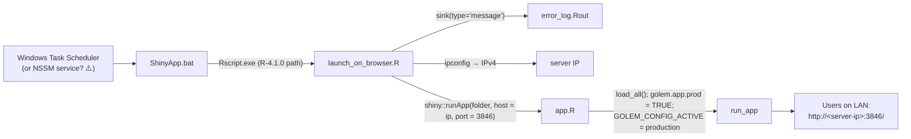

# 06 – Deployment

This page describes only what the repo shows. Everything I couldn't verify is marked. Read [08-open-questions.md](08-open-questions.md) before relying on any of it.

## What's in the repo, and what isn't

| Artifact | Present? |
|---|---|
| `Dockerfile` / `golem::add_dockerfile*` output | ❌ (only the unexecuted template call in [dev/03_deploy.R](../../dev/03_deploy.R)) |
| `rsconnect/`, `manifest.json` (Posit Connect / shinyapps.io) | ❌ (`app.R` mentions `rsconnect::deployApp()` in a comment, but there's no deployment record) |
| ShinyProxy / Shiny Server config | ❌ |
| CI/CD pipeline | ❌ |
| `app.R` | ✅ production entry point |
| `launch_on_browser.R` + `ShinyApp.bat` | ✅ Windows launcher |
| git tags / releases | ❌ (no tags) |

## How production runs (as far as the repo shows)



1. [ShinyApp.bat](../../ShinyApp.bat) runs `"C:\Program Files\R\R-4.1.0\bin\x64\Rscript.exe" %~dp0\launch_on_browser.R`.
2. [launch_on_browser.R](../../launch_on_browser.R):
   - opens `error_log.Rout` in **overwrite** mode (`"wt"`) at a **hard-coded production path** and sinks R *messages* (not stdout) into it ([L7-8](../../launch_on_browser.R#L7-L8))
   - takes the IPv4 address from `ipconfig` output ([L17-19](../../launch_on_browser.R#L17-L19)). If the server has several adapters this can pick up more than one address
   - calls `runApp(folder_address, launch.browser = FALSE, port = 3846, host = ip)` with a **hard-coded** `folder_address` ([L15](../../launch_on_browser.R#L15), [L24-27](../../launch_on_browser.R#L24-L27))
3. `runApp` on that folder executes [app.R](../../app.R): `pkgload::load_all()`, `options(golem.app.prod = TRUE)`, `Sys.setenv(GOLEM_CONFIG_ACTIVE = "production")`, `run_app()`.
4. The app runs straight from source in that folder. **No package is built or installed.** Working-directory-relative paths (`DB/…`, `data-raw/…`) resolve against the folder.

Nothing in the repo sets up HTTPS, a reverse proxy or a firewall rule. The app serves plain HTTP on the LAN.

> ⚠️ TO CONFIRM (deployment facts that aren't in the code):
> - The server's hostname or IP, and whether port 3846 is the only one in use. An old copy of `error_log.Rout` (formerly in git, now git-ignored) shows the app listening on port 3845 at some point.
> - **How the process is supervised.** CLAUDE.md and the root README say Windows Task Scheduler. But `.gitignore` lists `How to set up the NSSM service.txt`, and `service.out.log` / `service.err.log` exist, which suggests an NSSM Windows service. Which is current, and what's the trigger (at startup? restart on failure?)?
> - Which Windows account runs it. This matters for the `acs` keyring entry, which is per-user.
> - The R version on the server (the `.bat` says 4.1.0, `renv.lock` says 4.2.3), and whether `renv` is restored there.
> - How code gets to the server folder: `git pull` from GitHub, a manual copy, or a OneDrive sync?
> - Which branch is deployed. `dev` is 13 commits ahead of `master`, and `master` has 3 commits that aren't in `dev`. The last `master` commit is dated 2025-11-12.
> - Where `DB/csi_db.db` and `DB/credentials.sqlite` live on the server, and whether they're backed up.

## Release procedure (reconstructed; confirm before use)

Nothing in the repo documents a release process. The checklist below follows from how the app runs. It is a **proposal**, not existing practice.

1. **On your machine:**
   1. Merge to the deployed branch (⚠️ TO CONFIRM which one).
   2. Bump `Version` in [DESCRIPTION](../../DESCRIPTION). The sidebar reads it with `utils::packageVersion("CSIemail")`. `golem_version` in the git-ignored config is no longer displayed.
   3. `renv::snapshot()` if dependencies changed, then commit `renv.lock`.
   4. Run the manual smoke test in [05-setup-and-running.md](05-setup-and-running.md#tests).
   5. Tag the release: `git tag v0.x.y && git push --tags`.
2. **On the server:**
   1. **Back up `DB/`.** It isn't in git.
   2. Stop the app (the scheduled task or service, ⚠️).
   3. Update the code in the production folder (⚠️ method), keeping `DB/`, any local credential files and the server's own **`inst/golem-config.yml`**. That file is git-ignored and maintained by hand on the server.
      - If a release adds config keys (compare with [inst/golem-config.example.yml](../../inst/golem-config.example.yml)), add them to the server copy by hand.
      - Check the startup log for `Config key … is missing` warnings.

> ⚠️ **One-time step for the release that stopped tracking `golem-config.yml`.** If the server folder is a git checkout, the first `git pull` that includes the commit removing `inst/golem-config.yml` from git **deletes the server's copy**. Before pulling, copy `inst/golem-config.yml` somewhere outside the folder, pull, then copy it back. Later pulls leave it alone. This doesn't apply if you deploy by copying files.
>
> The commit that untracked the log files has the same effect: pulling it **deletes** the server's `error_log.Rout`, `service.*.log` and `launch_on_browser.log`.
> - Copy `error_log.Rout` first if you still need its contents.
> - **Stop the app before pulling**, as in step 2 above. The running app holds `error_log.Rout` open, and Windows won't let git delete an open file.
> - The launcher creates a fresh `error_log.Rout` on the next start.
>
> In the same release, add these keys to the server's `production:` section (the code falls back to the old behaviour if you forget):
> ```yaml
>   smtp_creds_source: keyring
>   cashier_emails_table: city_emails
> ```
> After the restart, the sidebar should show `Config: production`, `SMTP credentials: keyring` and `Cashier emails: city_emails`, with no (TEST) flag.
   4. If `renv.lock` changed: in that folder, run `Rscript -e "renv::restore()"` **with the same R version the launcher uses**.
   5. Start the app again, then check `error_log.Rout` (it logs the active profile, SMTP source and cashier table) and open `http://<server-ip>:3846/`.
   6. Log in and do a read-only check: load files, generate reports, **don't send**.

## Rollback

There are no release tags yet, so for now a rollback means going back to a known commit:

1. Stop the app.
2. In the production folder, `git checkout <previous-commit-or-tag>`, or copy back the previous folder if code isn't deployed with git (⚠️).
3. `renv::restore()` if `renv.lock` differs between the two versions.
4. Restore the `DB/` backup **only if** the release changed the data or schema. No release so far has run migrations; the schema has only been changed by hand.
5. Start the app again.

## Logs and monitoring

| Source | What ends up there |
|---|---|
| `error_log.Rout` (production path in [launch_on_browser.R:7](../../launch_on_browser.R#L7)) | R messages and warnings, `cli::cli_alert_*` output from the fct functions, and the "Listening on …" line. **It's overwritten on every restart** |
| stdout | `print()` and `cat()` calls (e.g. "Doing application cleanup", DB error objects). Not captured by the launcher, so whether it's kept depends on the supervisor (⚠️) |
| `service.out.log` / `service.err.log` (local, git-ignored) | stale files from 2022. Ignore them |

All `*.log` and `*.Rout` files are git-ignored, so logs never travel with the code.

There's no health check, uptime monitor or alerting.
